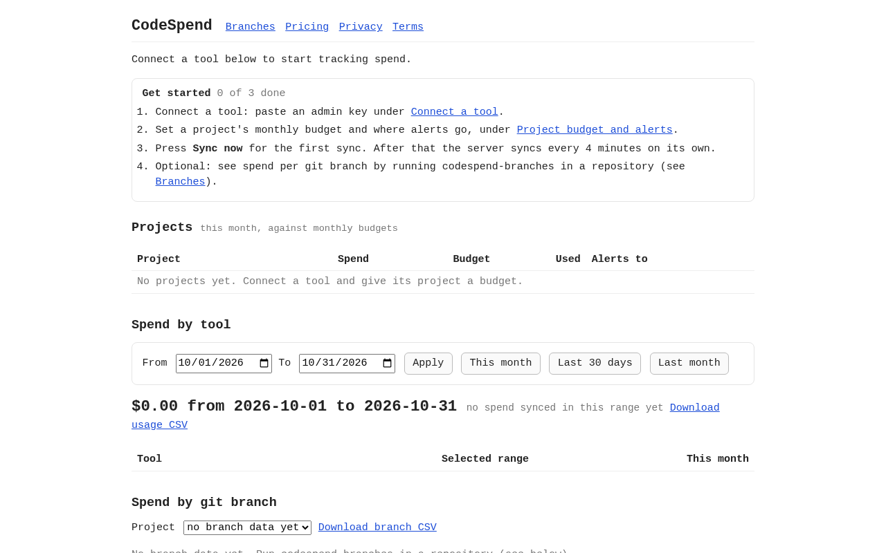
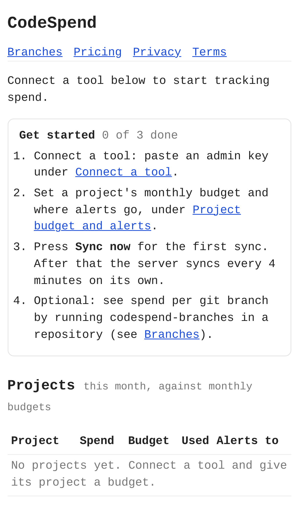
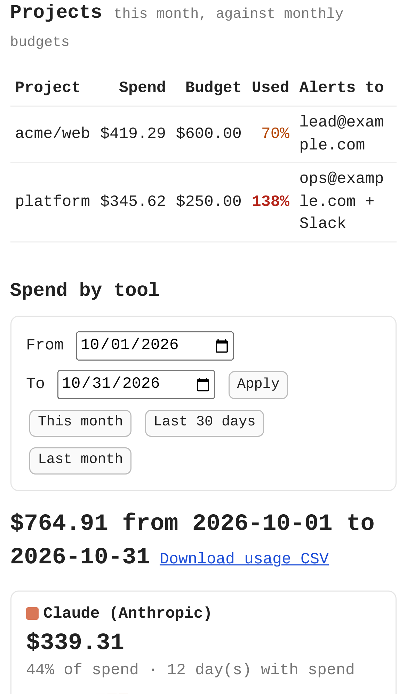
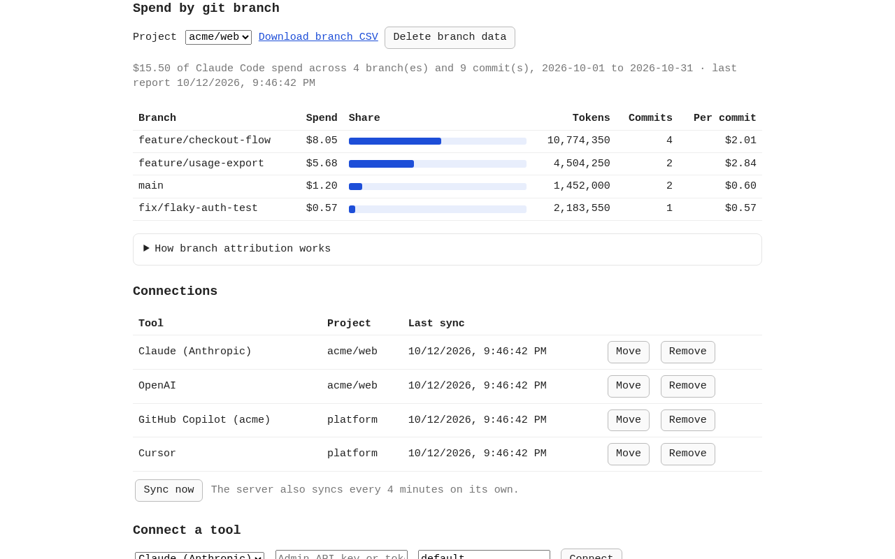
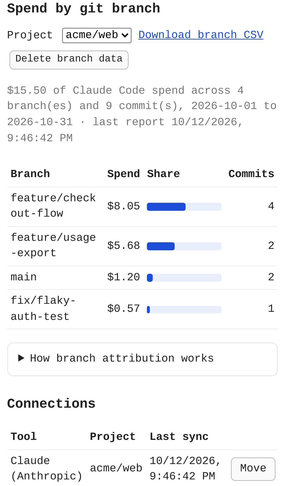

# CodeSpend — budget alerts and spend visibility for coding agents

## Screenshots


The first run on desktop: nothing is connected yet, and the 3-step checklist (connect, budget, sync) points the way.


The same start page on an iPhone 13.


After connecting Claude, OpenAI, Copilot and Cursor and pressing Sync now (sample data):
- `platform` is at 138% of its budget, with alerts sent to email and Slack.
- The month's spend is split across the per-tool charts and the stacked daily chart.


The same dashboard on a phone: budget status, the date-range picker and the per-tool breakdown.


The real `codespend-branches` CLI, run on a sample repository, charges each Claude Code call to the branch checked out at the time. The view shows spend, share, tokens, commits and cost per commit for each branch.


The branch breakdown on a phone.

_Screenshots come from `npm run screenshots`. The vendor APIs are stubbed with sample data, and no real key is used._

---

For developers and teams using AI coding agents. CodeSpend tracks spend across the Claude, Cursor, Copilot and OpenAI APIs and gives each project a monthly budget with email and Slack alerts at 50%, 80% and 100%. It also breaks Claude Code spend down by git branch.

- [Research](RESEARCH.md): findings and sources
- [PRD](PRD.md)
- [Roadmap](ROADMAP.md)
- [Build notes](BUILD.md): what's built, how to run and deploy it, what's left

## Getting started

You need Node 20.4 or later. There are no runtime dependencies.

```
npm start      # http://127.0.0.1:3000
npm test       # the whole suite, offline, no real keys
```

### 1. Connect a tool

Paste an admin key under **Connect a tool** and give it a project: a repo name like `acme/web`, or any tag.

| Tool | Key | Where to get it |
|---|---|---|
| Claude (Anthropic) | Admin API key | Console → Settings → Admin keys |
| OpenAI | Admin key | Platform → Settings → Organization → Admin keys |
| GitHub Copilot | Token that can read org billing, plus the org login | github.com → Settings → Developer settings → tokens (org owner or billing manager) |
| Cursor | Team Admin API key | Dashboard → Settings → Advanced → Admin API keys |

Keys are encrypted on the server and never shown again. **Remove** deletes a key and everything synced with it. Revoke the key at the vendor too.

### 2. Set a budget and where alerts go

Under **Project budget and alerts**, set a monthly budget in USD, an email address, and optionally a Slack incoming-webhook URL. To make a free webhook: api.slack.com/apps → Create app → Incoming Webhooks.

Alerts fire at 50%, 80% and 100% of the budget, once per threshold per month.

### 3. Sync

Press **Sync now** once. After that the server syncs every 4 minutes on its own, so an over-budget alert goes out within 5 minutes of the vendor reporting the usage.

### 4. Optional: spend per git branch

Billing APIs only report spend per key and day, so the branch view is built on your machine instead. Run this inside a repository where you use Claude Code:

```
node /path/to/codespend/bin/codespend-branches.mjs             # post to http://127.0.0.1:3000
node /path/to/codespend/bin/codespend-branches.mjs --dry-run   # print only
npm run branches -- --repo ~/src/acme-web --server http://127.0.0.1:3000   # from the codespend folder
```

It reads Claude Code's logs (`~/.claude/projects`, or `$CLAUDE_CONFIG_DIR`) and the repository's reflog. It charges each call to the branch that was checked out at that moment and prices it at Anthropic's list price. Then it sends per-day, per-branch totals: cost, tokens and commits.
- It never sends prompts, code or file paths.
- Running it again replaces its earlier report.
- Teammates who run it for the same project add up.
- Branch costs are estimates and don't count toward budgets.

Options:

| Option | Default |
|---|---|
| `--project` | owner/repo from the origin remote |
| `--server` | `$CODESPEND_URL` or `http://127.0.0.1:3000` |
| `--since YYYY-MM-DD` | the 1st of last month |

### 5. Date ranges and CSV

The date picker changes the tool charts and the branch view. Budgets always stay month-to-date.

**Download usage CSV** gives `date,tool,project,cost_usd`. **Download branch CSV** gives `date,project,branch,cost_usd,tokens,commits`. Both follow the selected range.

### Running it for others (operator settings)

All of these are optional environment variables:

| Variable | Purpose |
|---|---|
| `CODESPEND_ENCRYPTION_KEY` | 32 bytes, base64 (`openssl rand -base64 32`). It encrypts stored keys. Without it, a `secret.key` file is generated next to the data file. |
| `STRIPE_PAYMENT_LINK` | The $9/month Stripe Payment Link (`https://buy.stripe.com/...`), shown as **Upgrade**. |
| `STRIPE_PORTAL_LINK` | The Stripe customer-portal login link (`https://billing.stripe.com/...`), shown as **Manage or cancel**. |
| `CONTACT_EMAIL` | The address shown on `/privacy` and `/terms` for deletion requests. |
| `SLACK_WEBHOOK_URL` | Fallback Slack webhook for projects without their own. |
| `SENDGRID_API_KEY` + `ALERT_FROM` | Send real email. Without them, alerts go to `data/outbox.jsonl`. |
| `PORT` | Server port (default 3000). |
| `DB_FILE` | Data file (default `data/db.json`). |

Effort: Medium · Confidence: Medium

_Researched by the idea pipeline on 2026-10-11 ([original record](https://github.com/smithdavedesign/idea-factory/tree/main/ideas/codespend)); repo created on David's go-ahead 2026-10-11._
