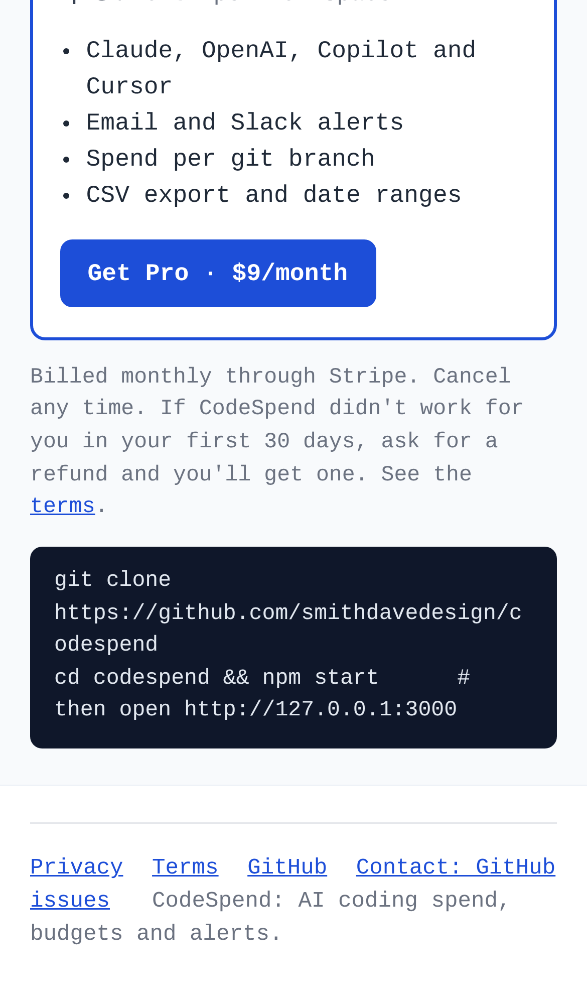
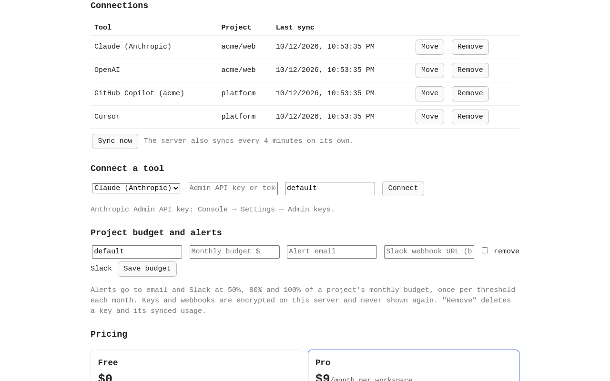
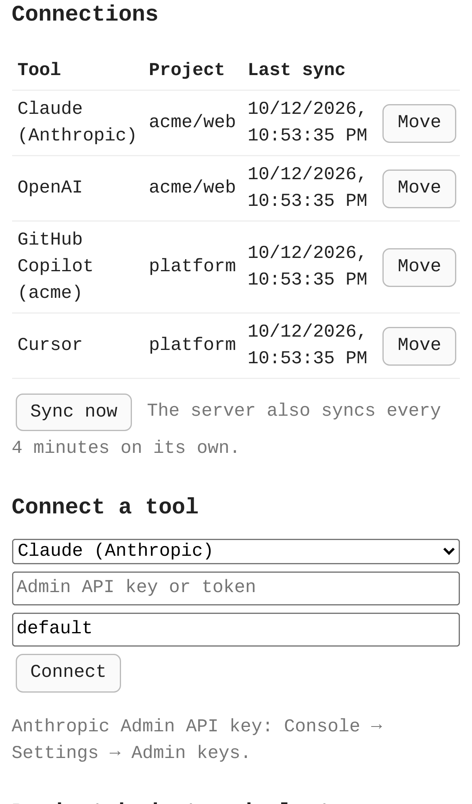
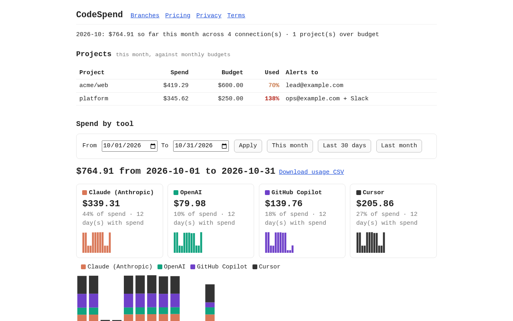

# CodeSpend — budget alerts and spend visibility for coding agents

## Screenshots


The public start page (`npm run build`) explains the product and shows the **Get Pro · $9/month** button, because a payment link is set.


The bottom of the same page on an iPhone 13: the Pro plan with **Get Pro** above the footer links (Privacy, Terms, GitHub, contact).


The core action in the dashboard: Claude, OpenAI, Copilot and Cursor are connected through the real UI, each shows its last sync, and **Sync now** is ready.


The same connections and **Sync now** on a phone.


The result of Sync now: `platform` is at 138% of its budget, with alerts sent to email and Slack, and the month's spend is split by tool.


The same budgets, date range and per-tool spend on a phone.

_Screenshots come from `npm run screenshots`. The vendor APIs are stubbed with sample data, no real key is used, and the payment link is a placeholder._

---

For developers and teams using AI coding agents. CodeSpend tracks spend across the Claude, Cursor, Copilot and OpenAI APIs and gives each project a monthly budget with email and Slack alerts at 50%, 80% and 100%. It also breaks Claude Code spend down by git branch.

- [Research](RESEARCH.md): findings and sources
- [PRD](PRD.md)
- [Roadmap](ROADMAP.md)
- [Build notes](BUILD.md): what's built, how to run and deploy it, what's left

## Getting started

You need Node 20.4 or later. There are no runtime dependencies.

```
npm start      # http://127.0.0.1:3000
npm test       # the whole suite, offline, no real keys
```

### 1. Connect a tool

Paste an admin key under **Connect a tool** and give it a project: a repo name like `acme/web`, or any tag.

| Tool | Key | Where to get it |
|---|---|---|
| Claude (Anthropic) | Admin API key | Console → Settings → Admin keys |
| OpenAI | Admin key | Platform → Settings → Organization → Admin keys |
| GitHub Copilot | Token that can read org billing, plus the org login | github.com → Settings → Developer settings → tokens (org owner or billing manager) |
| Cursor | Team Admin API key | Dashboard → Settings → Advanced → Admin API keys |

Keys are encrypted on the server and never shown again. **Remove** deletes a key and everything synced with it. Revoke the key at the vendor too.

### 2. Set a budget and where alerts go

Under **Project budget and alerts**, set a monthly budget in USD, an email address, and optionally a Slack incoming-webhook URL. To make a free webhook: api.slack.com/apps → Create app → Incoming Webhooks.

Alerts fire at 50%, 80% and 100% of the budget, once per threshold per month.

### 3. Sync

Press **Sync now** once. After that the server syncs every 4 minutes on its own, so an over-budget alert goes out within 5 minutes of the vendor reporting the usage.

### 4. Optional: spend per git branch

Billing APIs only report spend per key and day, so the branch view is built on your machine instead. Run this inside a repository where you use Claude Code:

```
node /path/to/codespend/bin/codespend-branches.mjs             # post to http://127.0.0.1:3000
node /path/to/codespend/bin/codespend-branches.mjs --dry-run   # print only
npm run branches -- --repo ~/src/acme-web --server http://127.0.0.1:3000   # from the codespend folder
```

It reads Claude Code's logs (`~/.claude/projects`, or `$CLAUDE_CONFIG_DIR`) and the repository's reflog. It charges each call to the branch that was checked out at that moment and prices it at Anthropic's list price. Then it sends per-day, per-branch totals: cost, tokens and commits.
- It never sends prompts, code or file paths.
- Running it again replaces its earlier report.
- Teammates who run it for the same project add up.
- Branch costs are estimates and don't count toward budgets.

Options:

| Option | Default |
|---|---|
| `--project` | owner/repo from the origin remote |
| `--server` | `$CODESPEND_URL` or `http://127.0.0.1:3000` |
| `--since YYYY-MM-DD` | the 1st of last month |

### 5. Date ranges and CSV

The date picker changes the tool charts and the branch view. Budgets always stay month-to-date.

**Download usage CSV** gives `date,tool,project,cost_usd`. **Download branch CSV** gives `date,project,branch,cost_usd,tokens,commits`. Both follow the selected range.

### Running it for others (operator settings)

All of these are optional environment variables:

| Variable | Purpose |
|---|---|
| `CODESPEND_ENCRYPTION_KEY` | 32 bytes, base64 (`openssl rand -base64 32`). It encrypts stored keys. Without it, a `secret.key` file is generated next to the data file. |
| `STRIPE_PAYMENT_LINK` | The $9/month Stripe Payment Link (`https://buy.stripe.com/...`), shown as **Get Pro**. Without it, or if it isn't a `buy.stripe.com` link, the button is hidden. |
| `STRIPE_PORTAL_LINK` | The Stripe customer-portal login link (`https://billing.stripe.com/...`), shown as **Manage or cancel**. |
| `CONTACT_EMAIL` | The address shown on `/privacy` and `/terms` for deletion requests. |
| `SLACK_WEBHOOK_URL` | Fallback Slack webhook for projects without their own. |
| `SENDGRID_API_KEY` + `ALERT_FROM` | Send real email. Without them, alerts go to `data/outbox.jsonl`. |
| `PORT` | Server port (default 3000). |
| `DB_FILE` | Data file (default `data/db.json`). |
| `SITE_URL` | The public site's address, for canonical and share links (default: Vercel's production domain, else `https://codespend.vercel.app`). |

### The public site

`npm run build` writes the public website into `site/`: the landing page, `/privacy`, `/terms`, `robots.txt`, `sitemap.xml` and the share image `og.png` (drawn by code). Vercel builds and serves it (`vercel.json`). It is static: the dashboard, which holds keys and has no login, is never deployed there. It reads `SITE_URL`, `STRIPE_PAYMENT_LINK` and `CONTACT_EMAIL` at build time, so changing one needs a redeploy.

Every page loads `public/beacon.js`. On the Vercel production deployment only, it sends three anonymous events to RepoHQ: `visit`, `activate` and `checkout` (see `/privacy`). It never sends anything from a server you run yourself, from automated browsers, or when `localStorage["repohq:notrack"]` is set. [LAUNCH-READY.md](LAUNCH-READY.md) has the details.

Effort: Medium · Confidence: Medium

_Researched by the idea pipeline on 2026-10-11 ([original record](https://github.com/smithdavedesign/idea-factory/tree/main/ideas/codespend)); repo created on David's go-ahead 2026-10-11._
